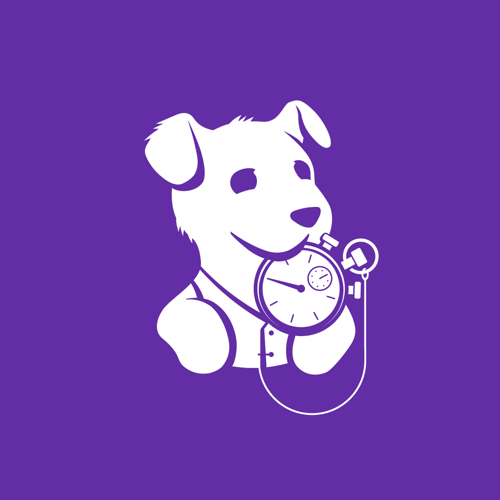

# PHP Profiler



The profiler is implemented in Rust. To see the currently required Rust
version, refer to the [rust-toolchain.toml](rust-toolchain.toml) file. The profiler
requires PHP 7.1+ and supports both release and debug PHP builds.

## Allocation size accounting

Allocation profiling rounds requested sizes to Zend MM size classes before
sampling. Recorded allocation bytes (including live-heap samples) and the
numeric `size class` label use the same rounded size. These roundings do not
include debug metadata or the heap-protection minimum, and may differ if a
custom allocator is used. The label separates size classes for Poisson
upscaling to prevent large errors if the same stack + labels have the large
variances in allocation size e.g. 32 bytes and 4,096 bytes.

## Time Profiling

The profiler sets the Zend VM interrupt flag approximately every 10ms. The
Zend Engine will handle this interrupt at the next place it's safe to do so.
Notably, this waits until an internal function like `curl_exec` has been
popped off the stack. This information is quite valuable, so this extension
installs a `zend_execute_internal` hook which also checks the interrupt and
handles the profiler's portion of the interrupt, but doesn't clear the
interrupt. This allows interrupts to continue as normal for other extensions
while allowing the profiler to see the internal function.

When the interrupt handler runs, it collects the wall-time and cpu-time since
the last run. This makes the cpu-time biased towards functions which do I/O,
but on the other hand it is very cheap to gather. This can be fixed by having
separate timers for wall-time and cpu-time, but if not done carefully this can
accidentally double the amount of latency and cpu overhead the profiler has on
the process.

## Compiling

Select matching `php`, `phpize`, and `php-config` executables on `PATH`, then
initialize the submodules with `git submodule update --init --recursive`.
Run the appropriate Make target from the repository root:

| Product | Command | Loadable extension |
|---------|---------|--------------------|
| Combined tracer and profiler | `make compile_combined` | `tmp/build_combined/modules/ddtrace.so` |
| Standalone profiler | `make compile_profiler` | `tmp/build_profiler/modules/datadog-profiling.so` |

These targets run phpize/configure/Make in isolated source copies. **Do not run
`phpize`/`configure` directly in the Git checkout root:** configure overwrites
the tracked Makefile. Manual phpize builds need a separate source/build copy.
Both modes invoke the root Cargo package and its profiler build helper, which
is how the profiler adapts to various PHP versions.

The combined product is shipped in release packages. Standalone profiling
remains supported and is built and tested by CI, but is not shipped. Do not
load standalone profiling alongside `ddtrace.so`; co-loading is rejected.
The targets above are development builds, not the Linux release ThinLTO
recipes; see [release builds](../.claude/ci/building-locally.md#for-release--packaging--system-tests-centos-7).

Standalone profiling defaults on when its module is explicitly loaded; combined
`ddtrace.so` defaults profiling off and is enabled with `DD_PROFILING_ENABLED=1`.
A direct `cargo build` does not produce a supported PHP extension artifact.
The [bindgen](https://crates.io/crates/bindgen) crate is used to generate Rust
bindings to the Zend Engine. Although bindgen is pretty good, there are things
like complex macro expansions which it doesn't understand, so there is a bit of
C code to do things that Rust/bindgen isn't good at.

The [src/bindings/mod.rs](src/bindings/mod.rs) file manually defines certain
structs and function definitions instead of letting bindgen handle it. This
allows us to gloss over minor differences in const-correctness in the engine
definitions across versions, as well as provide more idiomatic types in some
cases where they are ABI compatible.

## Testing

From the repository root, run the VM-independent Rust tests with the selected
PHP toolchain supplied explicitly:

```sh
DDTRACE_PHP_INCLUDES="$(php-config --includes)" \
cargo test --no-default-features --features profiling
```

These tests do not substitute for the PHP engine. Stack walking and other
engine-dependent behavior are tested inside PHP using the PHPT and
[correctness tests](tests/correctness).

To inspect a standalone profiler, run
`php -n -d extension=tmp/build_profiler/modules/datadog-profiling.so --ri datadog-profiling`.
For a combined build, run
`php -n -d extension=tmp/build_combined/modules/ddtrace.so --ri ddtrace`; it
registers only the `ddtrace` module and Zend extension identities. `-n` avoids
automatically loading another installed tracer or profiler from INI files.

The following command will help you run the [PHPT tests](tests/phpt):

```sh
php -n /path/to/run-tests.php -n -p "$(command -v php)" \
  -d extension="$(pwd)/tmp/build_profiler/modules/datadog-profiling.so" profiling/tests/phpt
```

For profiler-focused testing of a combined artifact, disable the other runtime
products while leaving common configuration active:

```sh
DD_TRACE_ENABLED=0 \
DD_INSTRUMENTATION_TELEMETRY_ENABLED=0 \
DD_REMOTE_CONFIG_ENABLED=0 \
php -n /path/to/run-tests.php -n -p "$(command -v php)" \
  -d extension="$(pwd)/tmp/build_combined/modules/ddtrace.so" profiling/tests/phpt
```

The `run-tests.php` version has to match the PHP version used to run the tests.

## Benchmarks

The PHP timeline and exception workloads use `sirun` to compare profiling
disabled, profiling enabled, and profiling with timeline enabled. Their
definitions load the standalone development artifact, not a combined release
build. Use PHP configuration that does not auto-load another tracer/profiler.
Cargo features are fixed at configure time: if `tmp/build_profiler/` already
exists with different features, remove that generated build directory before
changing `PROFILER_FEATURES`. From the repository root:

```sh
make compile_profiler PROFILER_FEATURES=trigger_time_sample
cd profiling
sirun benches/timeline.json
sirun benches/exceptions.json
```

The timeline workload needs `trigger_time_sample` to collect samples explicitly.

## Troubleshooting

#### Can't find the profiler library on macOS

Only the phpize/configure/Make output is a supported loadable extension. A
standalone Make build produces `tmp/build_profiler/modules/datadog-profiling.so`;
a combined Make build produces `tmp/build_combined/modules/ddtrace.so`.
Do not load or copy Cargo's intermediate cdylib from the target directory.
